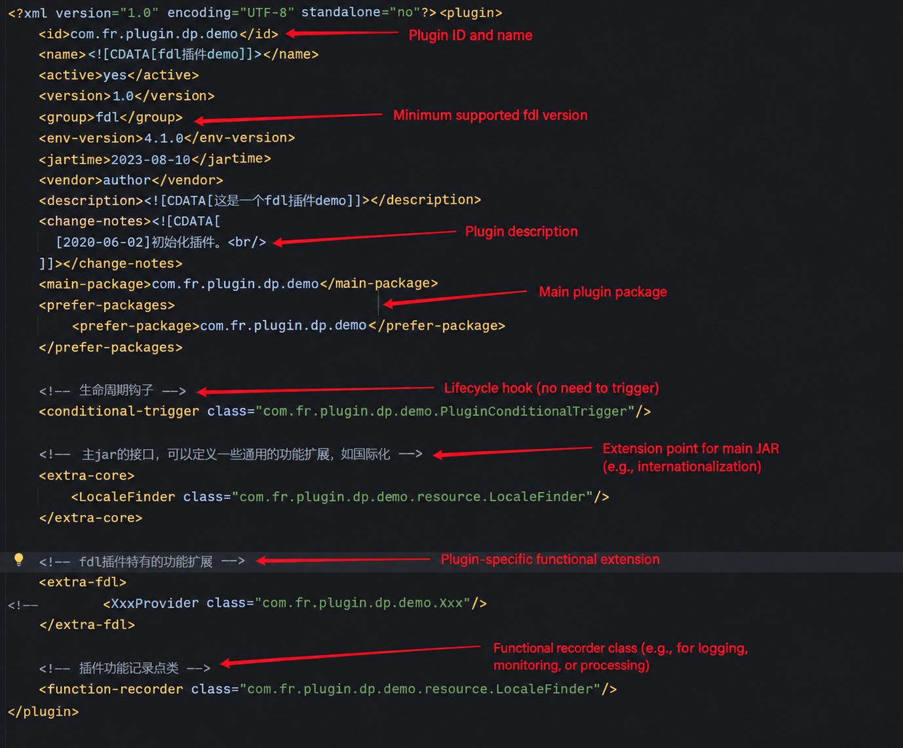
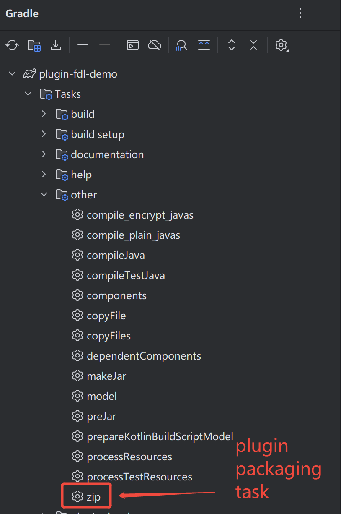
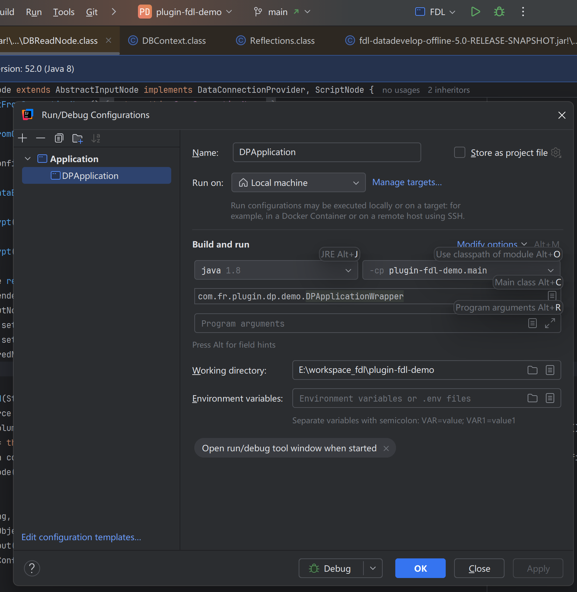
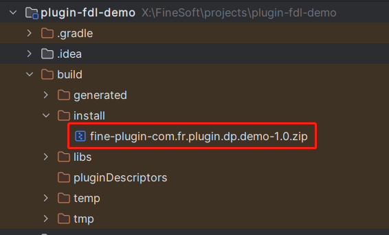

# Configure FineDataLink Plugin Development Environment


## 1. Project Preparation

External developers / secondary developers can run and debug plugins independently, without depending on the FDL source code.

1. First, download the plugin project template ( `(https://github.com/finereport-overseas/plugin-fdl-demo)`).
2. Unzip the file and open it in IDEA, choose **Import Gradle Project**, and adjust the project settings.
3. Modify the plugin id, version, and other information in `plugin.xml`.
4. Refresh the Gradle configuration.

After completing the above steps, you can start plugin development.


## 2. Plugin Development

During plugin development, note that **after each change to `plugin.xml`, you must re-run the Gradle refresh** 【Important】.

## 3. Code Debugging

Create a debug configuration in IDEA to debug the code.


## 4. Plugin Packaging

Run the Gradle packaging task in IDEA, or execute the packaging command in the plugin root directory:

```bash
# On Windows
.\gradlew.bat zip

# On Linux / macOS
./gradlew zip
```

After completion, the plugin zip package can be found in the `build` directory.

