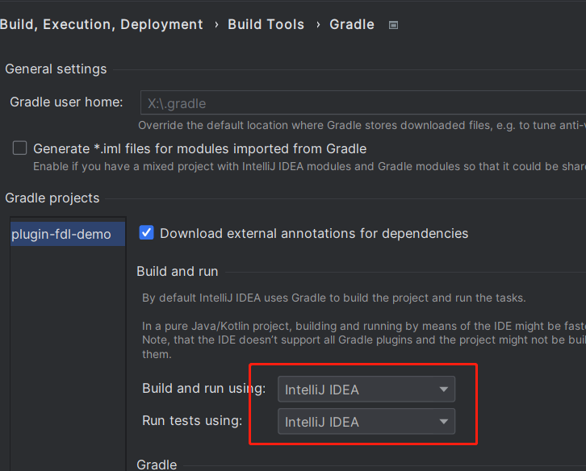
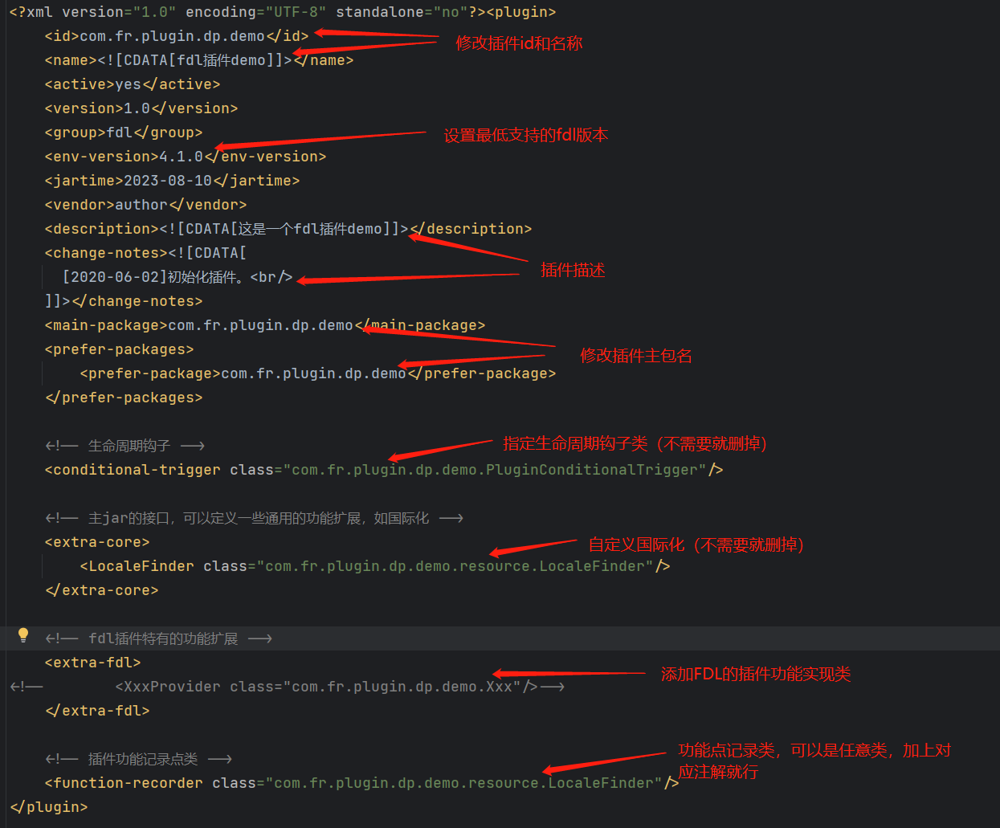
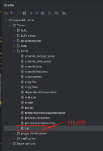

# 配置 FineDataLink 插件开发环境


## 1. 工程准备

外部开发者 / 二开人员可以在不依赖 FDL 源码的情况下单独运行、调试插件。

1. 首先下载插件工程模板（ `https://github.com/finereport-overseas/plugin-fdl-demo`）。
2. 解压 zip 文件并用 IDEA 打开，选择**导入 Gradle 工程**，并调整工程设置。
3. 修改 `plugin.xml` 中的插件 id、版本等信息。
4. 刷新 Gradle 配置。

完成以上步骤后，即可开始插件开发。


## 2. 插件开发

插件开发过程中需要注意：每次调整 `plugin.xml` 之后，都需要**重新执行刷新 Gradle 配置**的操作【重要】。

## 3. 代码调试

在 IDEA 中创建调试配置即可进行代码调试。


## 4. 插件打包

在 IDEA 中执行 Gradle 的打包任务，或在插件根目录下执行打包命令：

```bash
# Windows 下执行
.\gradlew.bat zip

# Linux / macOS 下执行
./gradlew zip
```

完成后可以在 `build` 目录下找到插件的 zip 包。


